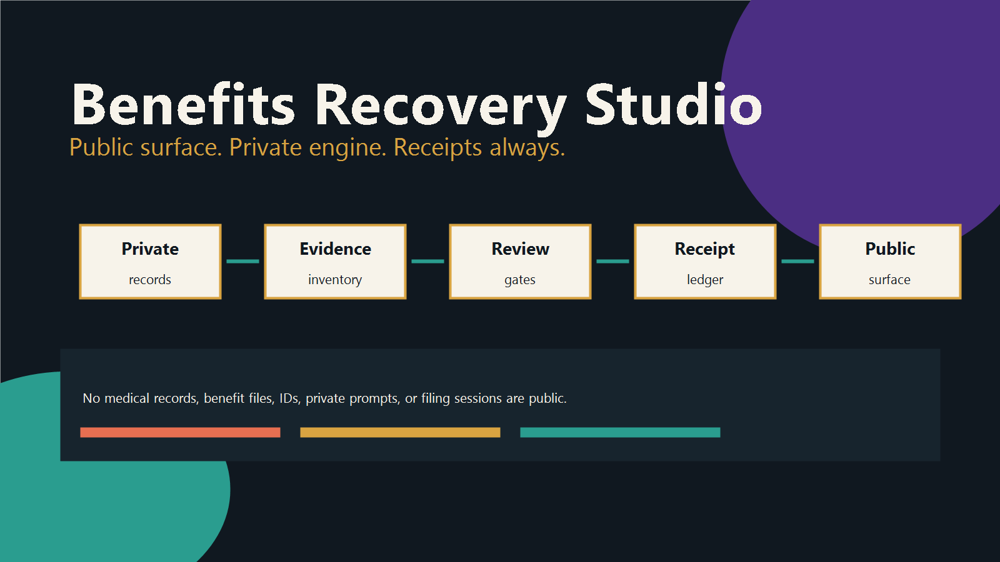
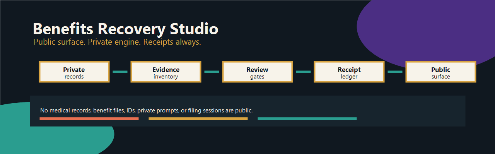
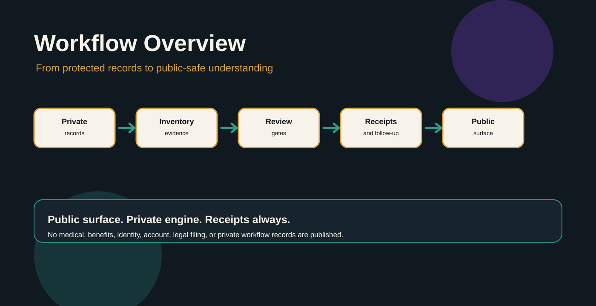
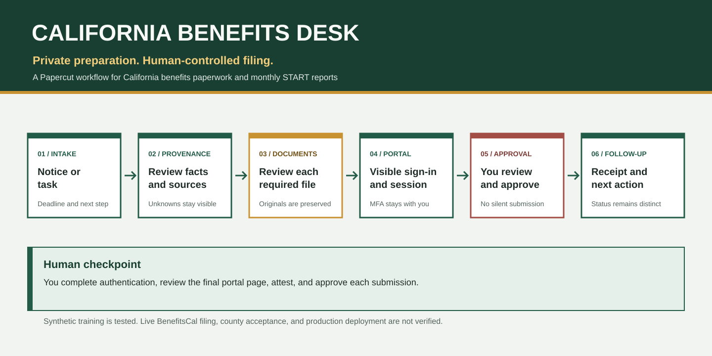
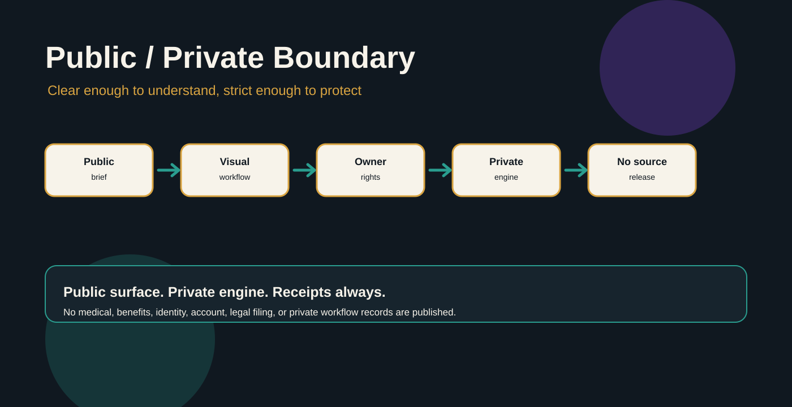
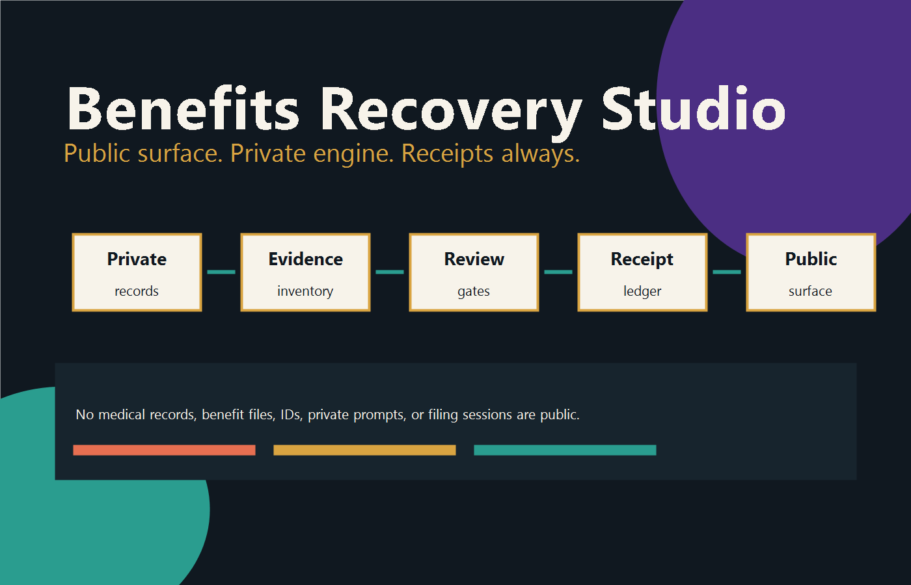

# Benefits Recovery Studio

Benefits Recovery Studio is the public-safe project surface for a private,
review-first California benefits paperwork workflow. It explains how
applications, benefit notices, evidence packets, deadlines, and follow-up can
be organized without publishing the records underneath.

> This repository is a project overview, not the Papercut source code, an
> operational service, an agency site, or a data room.

## Why It Matters

Administrative systems often ask disabled people, caregivers, working families,
and people under stress to manage dense forms, deadlines, proofs, notices,
calls, and portals at the exact moment their capacity is lowest. Benefits
Recovery Studio treats paperwork survival as infrastructure: evidence ledgers,
clear status, reversible packets, review gates, and receipts.

## Who It Is For

This surface is for people evaluating Faith Cheltenham's administrative
recovery, document-operations, accessibility, and protected-workflow approach:
collaborators, institutions, advocates, civic-tech builders, journalists,
funders, and partners who need the high-level model without access to private
records.

## How It Works

The public model is simple:

1. identify a task, notice, deadline, or recurring report;
2. review facts against their sources and mark uncertainty;
3. check each document and resolve contradictions;
4. use a visible, supervised portal session when needed;
5. keep authentication, attestations, signatures, and final submission under
   human control;
6. save a receipt and the next follow-up action.

## California Benefits Desk

The California Benefits Desk is a private feature track inside Papercut for
California benefits paperwork, including document responses and monthly START
activity packets.

Its design emphasizes source-linked answers, an explicit readiness queue,
reviewed documents, contradiction handling, supervised portal steps, and
separate prepared, signed, uploaded, submitted, and receipt-verified states.
MFA and the final approval remain human checkpoints.

**Status note - 2026-11-09:** the local UI build and synthetic BenefitsCal
training flow passed. This verifies the local interface and training workflow
only. Live BenefitsCal filing, production deployment, county acceptance, and
agency affiliation have not been verified. No real case records, credentials,
or portal captures are included in this repository.

## Public / Private Boundary

Public materials explain the method, values, ownership, and high-level workflow.
Private materials include actual forms, medical records, benefit notices,
identity records, filing sessions, prompts, local automation, account access,
legal signatures, and private receipts.

## Visual Gallery

The visual system uses calm contrast, clear boundaries, and human review gates:
private records stay protected; public understanding stays strong.

## Current Status

- Historical project notes (2026-06-18): public export created, v1 slug available, and a website draft prepared for https://faithcheltenham.com/projects/benefits-recovery-studio/.
- The earlier privacy-readiness label is historical context, not a current security audit or production approval.
- Repository slug: `benefits-recovery-studio`.

The dated status note above records what was locally verified on 2026-11-09;
it does not replace a production or privacy review.

## Learn More

- Website draft path: `/projects/benefits-recovery-studio/`
- Owner site: [FaithCheltenham.com](https://faithcheltenham.com/)
- Papercut product overview: [thefayth/papercut](https://github.com/thefayth/papercut)
- Public repository URL: [thefayth/benefits-recovery-studio](https://github.com/thefayth/benefits-recovery-studio)

All rights reserved. No source release. No public license. No redistribution.
No training permission. No commercial reuse.
